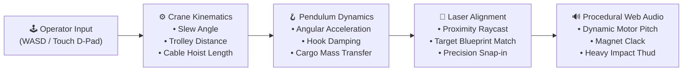

<div align="center">

# 🏗️ SkyBuild 3D: Tower Crane Simulator

### **High-Precision 3D WebGL Construction Physics Simulator**
*Developed by **Md Mujahidul Islam** (@mujahidul80)*

<p align="center">
  <a href="https://mujahidul80.github.io/skybuild-3d-tower-crane-simulator/"></a>
  <a href="https://vercel.com/new/clone?repository-url=https%3A%2F%2Fgithub.com%2Fmujahidul80%2Fskybuild-3d-tower-crane-simulator"></a>
  <a href="https://github.com/mujahidul80/skybuild-3d-tower-crane-simulator/stargazers"></a>
  <a href="LICENSE"></a>
</p>

<p align="center">
  
  
  
  
  
</p>

---

[🌐 Live Demo](#-live-demo--preview) •
[✨ Key Features](#-key-features) •
[🕹️ Controls Manual](#%EF%B8%8F-crane-operator-manual) •
[🏗️ Blueprint Contracts](#%EF%B8%8F-blueprint-contracts) •
[📐 Physics Architecture](#-physics--simulation-pipeline) •
[🚀 Deployment](#-deployment-options) •
[👤 Developer](#-developer--contact)

</div>

---

## 🌐 Live Demo & Preview

> **💡 Instant Play on Web Browser:**  
> SkyBuild 3D is a **100% self-contained browser simulation**. Procedural Three.js 3D models, Web Audio sound effects, and physics run in real time with zero plugins or downloads required.

- 🔗 **Play Live on Web Browser:** [**Launch SkyBuild 3D**](https://mujahidul80.github.io/skybuild-3d-tower-crane-simulator/)
- 🚀 **1-Click Free Hosting:** Deploy to Vercel with custom domain in under 60 seconds!

---

## ✨ Key Features

1. **Articulated Industrial Tower Crane:**
   - 360-degree jib slewing rotation.
   - Forward and reverse trolley horizontal traversal along the jib track.
   - Dynamic cable hoisting up/down with realistic cable physics and hook pendulum swinging.

2. **Laser Alignment & Auto-Snap Guidance:**
   - Color-coded vertical laser guide projected beneath the electromagnet hook.
   - Turns **Emerald Green** when aligned with target blueprint coordinates.
   - Real-time precision accuracy calculation (percentage scoring and contract budget rewards).

3. **Procedural Web Audio Engine:**
   - Realistic electric crane motor hum that scales pitch with movement speed.
   - Electromagnet latch and release audio pulses.
   - Heavy structural impact thuds on block placement.
   - Mission completion fanfare.

4. **Multi-Camera Perspective:**
   - **Camera 1:** Free Orbit Camera (left-click drag & zoom).
   - **Camera 2:** Top-Down Precision Camera tracking hook position.
   - **Camera 3:** Operator Cabin Camera mounted high on the slewing mast.

5. **Touch & Mobile Controls Ready:**
   - Complete on-screen touch D-Pad and action buttons for smartphones and tablets.

---

## 🕹️ Crane Operator Manual

| Function | Desktop Keyboard | Mobile / Touch Control |
| :--- | :--- | :--- |
| **Slew Crane Jib** | `A` / `D` or `Left` / `Right` | D-Pad `LEFT` / `RIGHT` |
| **Trolley Travel** | `W` / `S` or `Up` / `Down` | D-Pad `OUT` / `IN` |
| **Hoist Cable** | `Q` / `E` or `Shift` / `Ctrl` | Hoist `UP` / `DOWN` |
| **Grab / Place Block** | `SPACEBAR` | `🧲 GRAB` / `⬇ PLACE` Button |
| **Rotate Piece 90°** | `R` Key | `↻ 90°` Button |
| **Switch Camera** | `C` Key | `🎥 CAMERA` Button |
| **Orbit & Zoom** | Mouse Drag & Scroll | One-Finger Drag & Pinch |

---

## 🏗️ Blueprint Contracts

1. **Level 1: Site Office** — Place concrete perimeter walls, partition blocks, and prefabricated roof slabs.
2. **Level 2: Industrial Warehouse** — Erect heavy steel I-beams, cross trusses, and industrial wall sections.
3. **Level 3: Skyscraper Core** — Hoist elevator shaft columns, structural pillars, and exterior glass panels.
4. **Free Build Sandbox Mode** — Choose materials from the bottom toolbar (Concrete, Steel, Glass, Pillars, Roofs) and build custom architecture freely.

---

## 📐 Physics & Simulation Pipeline



---

## 🚀 Deployment Options

### 1-Click Vercel Deploy
[](https://vercel.com/new/clone?repository-url=https%3A%2F%2Fgithub.com%2Fmujahidul80%2Fskybuild-3d-tower-crane-simulator)

### GitHub Pages (Automated CI/CD Included)
Pre-configured `.github/workflows/deploy.yml` action automatically publishes pushes on `main` to `https://mujahidul80.github.io/skybuild-3d-tower-crane-simulator/`.

### Local Development
```bash
# Clone repository
git clone https://github.com/mujahidul80/skybuild-3d-tower-crane-simulator.git
cd skybuild-3d-tower-crane-simulator

# Start local server
npm run dev
# or
npx serve .
```

---

## 👤 Developer & Contact

**Md Mujahidul Islam**  
*Game Developer • Creative Web Developer • Packaging Designer*

<p align="left">
  <a href="https://wa.me/8801571432927"></a>
  <a href="mailto:mdmujahidul31@gmail.com"></a>
  <a href="https://t.me/failuretm"></a>
  <a href="https://github.com/mujahidul80"></a>
  <a href="https://www.behance.net/mujahidulib"></a>
  <a href="https://mujahidulib.blogspot.com"></a>
  
</p>

---

## 📄 License

This simulation is open-source under the [MIT License](LICENSE).  
© 2026 **Md Mujahidul Islam**. All rights reserved.
